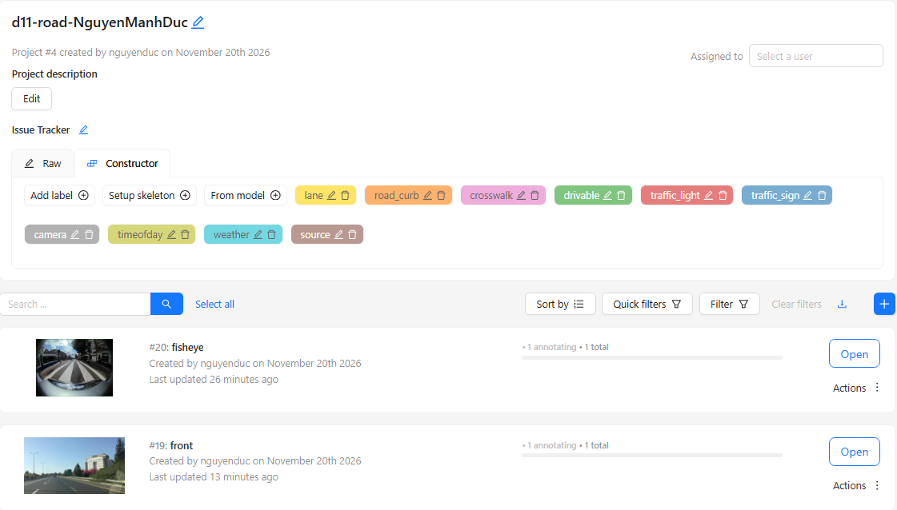
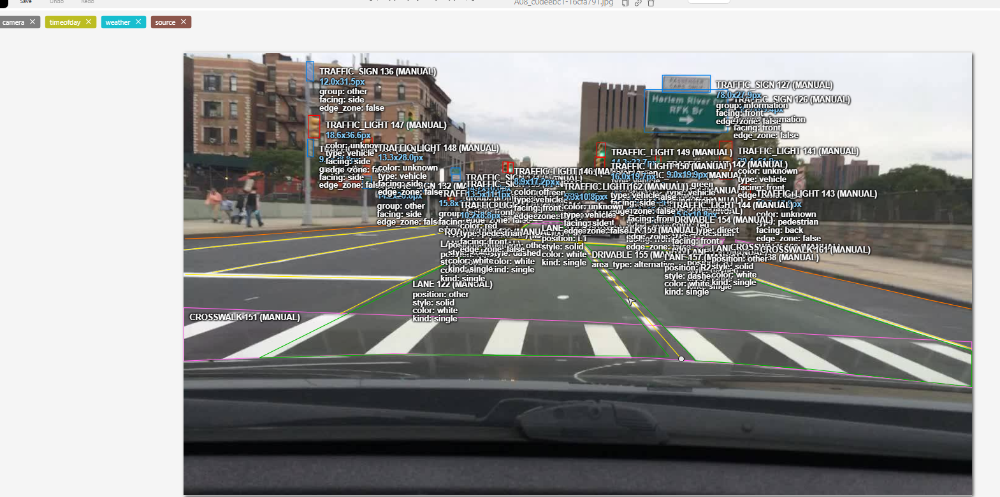
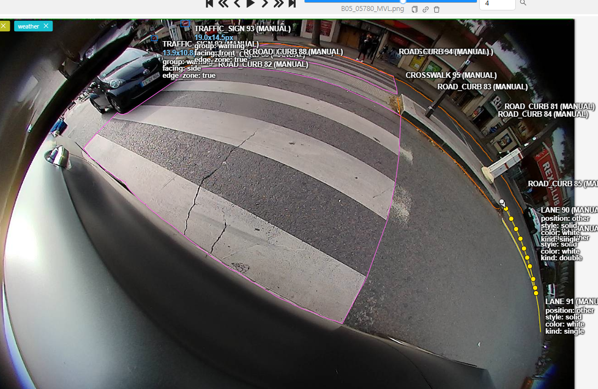
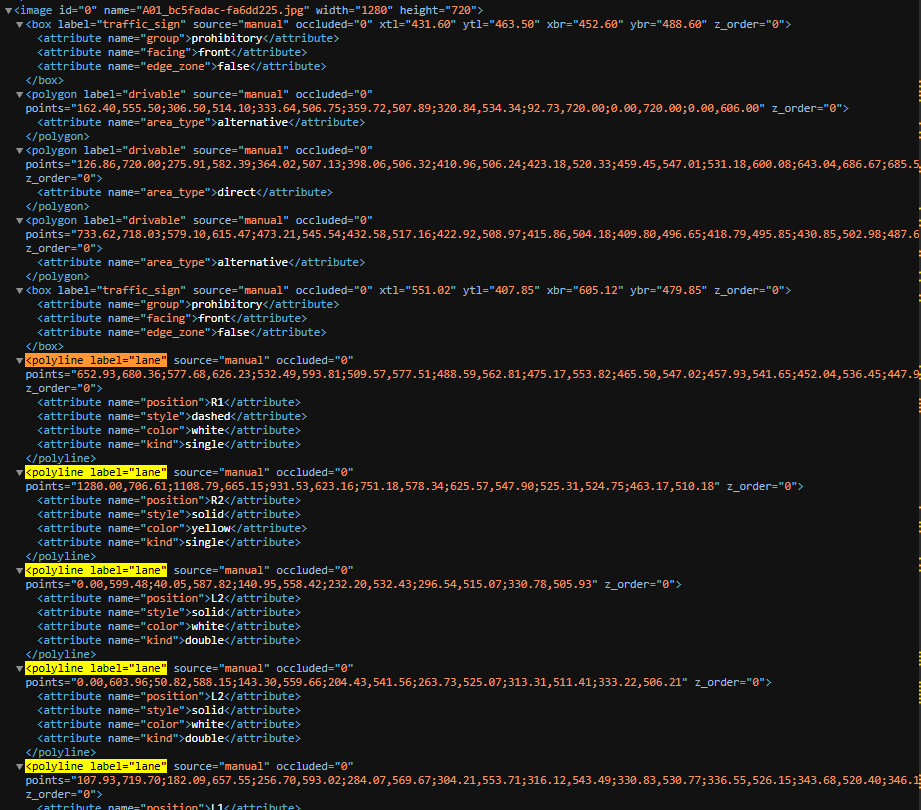

# Báo cáo cá nhân — Ngày 11

**Họ tên** Nguyễn Mạnh Đức · **Mã học viên** 2A202603153 
**Phiên bản CVAT** 2.74.1
**Guideline** Road v1.0 · **Manifest** revision 1  
**Thời điểm export theo XML (giờ Việt Nam)** front 21:41:21, fisheye 21:27:53, ngày 20/11/2026.  
**Số lần nộp lại sau Rework** 0

## 1. Kiểm project

| Mục | Kết quả | Ghi chú |
| --- | --- | --- |
| 6 label, đúng kiểu | Đã xuất đủ 6 loại nhãn | Đối chiếu hai ZIP với Road v1.0. |
| Thuộc tính và giá trị | Đã rà bằng lint | Còn 19 cảnh báo chính và 9 cảnh báo nhẹ cần xem theo ảnh. |
| 4 tag ảnh | Đủ 20/20 ảnh | Gồm camera, timeofday, weather và source. |

**Kết thúc polyline** Dùng nút hoàn tất khi đã đặt điểm cuối. **Đặt tag** Chọn công cụ Tag, chọn nhãn rồi kiểm `value` trong Details. 

## 2. Số lượng đã gán

| Task | Ảnh | lane | road_curb | crosswalk | drivable | traffic_light | traffic_sign |
| --- | ---: | ---: | ---: | ---: | ---: | ---: | ---: |
| front | 12 | 47 | 9 | 11 | 26 | 36 | 45 |
| front-extra | 0/4 | 0 | 0 | 0 | 0 | 0 | 0 |
| fisheye | 8 | 19 | 30 | 16 | 4 | 8 | 12 |
| fisheye-extra | 0/4 | 0 | 0 | 0 | 0 | 0 | 0 |

Số liệu lấy từ hai ZIP.

## 3. Bảng ca khó

| Ảnh | Nhãn | Phân vân giữa | Đã chọn | Lý do |
| --- | --- | --- | --- | --- |
| A09 | lane | L1 hay R1 cho vạch trắng đứt | Rà theo vị trí khi nhìn từ xe | Vạch đứt bên phải làn ứng với R1. Cụm sọc trắng đôi ở trái cùng đánh dấu ranh L1. |
| A05 | lane | Có đủ dấu sơn để xác định L1 và R1 hay không | ZIP hiện có cả hai vị trí. Cần coach xác nhận. | Ảnh gốc chưa cho thấy rõ vạch sơn phân làn. Nếu coach xác nhận không thấy, bỏ các đường đã thêm và ghi ngoại lệ QC1-02. |
| A06 | lane | Đoạn vạch bên trái và ranh bên phải | ZIP hiện có cả hai vị trí. Cần coach xác nhận R1. | Bên trái có đoạn sơn vàng nhìn thấy gần lối sang đường. R1 chưa thấy rõ trên ảnh. |
| B05–B08 | lane | L1/R1 hay other ở camera hai bên | other | Road v1.0 dùng other cho lane ở fisheye_left và fisheye_right. |

## 4. Phiếu QC 1 nhận được

**Bạn kiểm lô của tôi** Nguyễn Thanh Quang - 2A202603083 
**Quyết định nhận được** Hold

| Mã lỗi | Số lỗi | Đồng ý? | Đã sửa? |
|---|---:|---|---|
| QC1-03 | 1 | Có | Đã đổi `position` của vạch trong ảnh B06 thành `other`. |

Khi tự kiểm, tôi đã bổ sung 4 tag cho B05, sửa `position` của các lane camera bên và rà lại các cảnh báo vị trí làn trong bộ front.

## 5. Kiểm file export

| File | Mở lại được? | Số shape ảnh 1 (job / file) | Số shape ảnh 2 (job / file) | Tag camera có trong XML? |
| --- | --- | --- | --- | --- |
| nguyenmanhduc-front.zip | Có | 10 / A01: 10 | 7 / A02: 7 | Có, 12/12 ảnh |
| nguyenmanhduc-fisheye.zip | Có | 6 / B01: 6 | 13 / B02: 13 | Có, 8/8 ảnh |

Hai ZIP đều có `contains_images = false` và SHA-256 khớp với manifest. Lint báo 0 nặng, 19 chính và 9 nhẹ.

## 6. Ảnh chụp màn hình

1. Tab Labels của project

   

2. Ảnh front đã gán nhãn

   

3. Ảnh fisheye phóng to đoạn polyline cong

   

4. Đoạn XML có thẻ polyline lane

   

## 7. Tự đánh giá

Lỗi lặp lại nhiều trong tự kiểm là đặt `position` chưa đúng. Lần sau tôi sẽ đối chiếu hướng camera trước và mở Details kiểm tra lại thuộc tính ngay sau khi vẽ từng vạch.

Khi chuẩn bị dữ liệu cho mô hình nhận diện làn, polyline cung cấp vị trí vạch và thuộc tính `position` xác định vai trò của vạch đối với làn xe. Ví dụ, nếu gán vạch đứt bên phải ở A09 thành L1, mô hình có thể học vị trí ranh trái từ các điểm thực tế nằm bên phải. Rà lại `position` trước khi export giúp tránh lỗi này.

